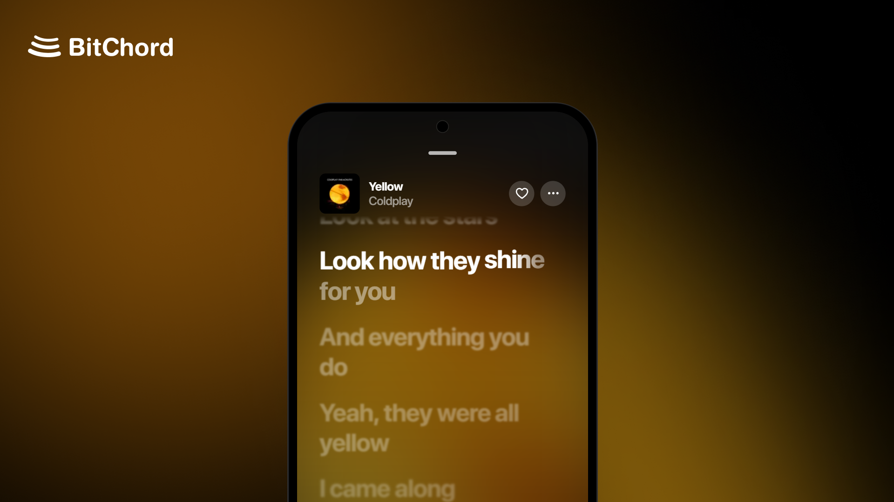

<div align="center">

<br/>
<br/>


# BitChord Mix

### Aesthetic YouTube Music Client — with a real AutoMix

<br/>

[](https://github.com/kushagrasinghx/BitChord/releases)
[](https://github.com/kushagrasinghx/BitChord/blob/main/LICENSE)
[](https://github.com/kushagrasinghx/BitChord/releases)
[](https://api.bitchord.kushagrasingh.in/api/stats/live)

<br/>

[**Download**](#download) · [**Features**](#features) · [**Contributing**](#contributing) · [**Support**](#support) · [**Disclaimer**](#disclaimer)

<br/>

<a href="https://fmhy.net/mobile#youtube-music" target="_blank" rel="noopener noreferrer"></a>
<a href="https://trendshift.io/repositories/177639?utm_source=repository-badge&amp;utm_medium=badge&amp;utm_campaign=badge-repository-177639" target="_blank" rel="noopener noreferrer"></a>

</div>

**Canonical source:** `survey-sudo/bitchord-mix`, development branch `ae3`.
See [REPOSITORY.md](REPOSITORY.md) for local/cloud paths and the repository consolidation.

> [!IMPORTANT]
> BitChord is not affiliated with, endorsed by, or connected to YouTube or Google in any way. Use it at your own discretion.

> [!NOTE]
> **This is the BitChord Mix fork** of [BitChord](https://github.com/kushagrasinghx/BitChord), based on upstream **v1.10**, by Kushagra Singh, under the same **GPL-3.0-or-later** license (see `LICENSE`). It is not the official app: the package is `com.music.bitchord.loopfix` and the label is **"BitChord Mix"**. Fork update checks use `survey-sudo/bitchord-mix`.
>
> Everything upstream ships is here. What this fork adds is one thing done properly: **AutoMix** — the transition engine was rebuilt so songs mix at musically correct points, beatmatch on both decks, skip silent intros, and separate vocals instead of filtering them.

---

<div align="center">



<h1><a id="features"></a>Features</h1>

<table>
  <tr>
    <td width="50%" valign="top">

#### Playback
- **Search, browse and play** anything available on YouTube Music.
- **Hi-Res lossless audio** — FLAC/ALAC from a configured module source, with YouTube Music as fallback.
- **Gapless playback with true crossfade**, adjustable 0–12s.
- **Automix [Beta]** — DJ-style transitions with beat-matching and tempo-stretching.
- **Offline downloads** — save tracks with embedded metadata.
- **Local music library** integration.
- **Background playback** via a proper foreground media session.
- **Apple-like lyrics animation** — credit to [binimum](https://github.com/binimum/am-lyrics).

#### Connectivity & Accounts
- **Sign in with your Google account** for personalized content.
- **Spotify integration** — connect your account to play your playlists and Liked Songs.
- **Discord Rich Presence** — in-app login, live track/artist/album and progress.
- **Scrobbling** to Last.fm and ListenBrainz.
- **Pluggable sources** — add, edit, test and health-check module sources.

    </td>
    <td width="50%" valign="top">

#### Experience
- **Animated album canvas** — motion artwork on the now-playing screen.
- **Word-synced lyrics** — word/syllable-level highlighting from multiple sources.
- **Lyrics providers** — credit to [lrc.red](https://lrc.red), [BiniLyrics](https://github.com/binimum), [BetterLyrics](https://github.com/better-lyrics/better-lyrics), [PaxSenix](https://lyrics.paxsenix.org), [LyricsPlus](https://github.com/ibratabian17/YouLyPlus), [SimpMusic](https://github.com/maxrave-dev/SimpMusic), [Unison](https://unison.boidu.dev), [Megalobiz](https://www.megalobiz.com), [KuGou](https://www.kugou.com), [LRCLIB](https://lrclib.net), [Musixmatch](https://www.musixmatch.com) and [Genius](https://genius.com).
- **Dynamic, artwork-driven theming** — Material palette extracted from album art.
- **Frosted-glass UI** — Telegram-style translucent bars via Haze, Material 3 theming.

#### Controls & Tweaks
- **Per-network audio quality** — separate quality ceilings for Wi-Fi and mobile data.
- **Playback speed control** (0.5×–2.0×) and **skip silence**.
- **Sleep timer** — fixed presets or "stop after this track".
- **System equalizer** integration.
- **Bit-perfect USB exclusive output** — sends lossless tracks to a USB DAC unchanged, at each track's own rate and bit depth. Thanks to [Mornye](https://github.com/mornyeapp/Mornye) for the reference.
- **Stats for nerds** — codec, bit depth, sample rate, and more on the now-playing screen.

    </td>
  </tr>
</table>

---

<div align="center">

<h1><a id="automix"></a>AutoMix</h1>

</div>

Upstream ships Automix as a beta that beatmatches and tempo-stretches. This fork replaces the transition engine end to end. Every item below is implemented in this tree, not aspirational.

### Transitions land where the music actually ends

- **Outro-aware exit selection** — candidates are scored across the whole tail of the track, latest-first, so a mix never abandons a final chorus to jump at a bridge or verse marker.
- **A real floor on exit points** — exits are clamped to the last ~30 s (or last 22 % on tracks over 90 s) instead of the old `musicEnd - 40` clamp that *lowered* the floor and cut songs early.
- **Final-chorus protection** — bridge/verse exits are only chosen when the outro is genuinely short and mostly unsung; otherwise the mix waits for the content end.
- **Bounded fade spans** — `CONTENT_END` transitions cap their ramp and total span so a long outro doesn't drag the fade start backwards.

### Song B enters on music, never on silence

- Leading **silence sections are detected and skipped** at both cue-selection and playback time, so the incoming deck starts at the first audible bar rather than fading in over a silent intro.
- Incoming cues honour `audibleStartTime`; a track that starts at `0.0` no longer stops the planner dead.

### Both decks beatmatch

- The incoming playback rate is **derived from the actual tempo ratio**, not hardcoded to `1.0`.
- **Parallel decode** of the outgoing and incoming regions replaced the sequential path that was dying with `decode 0 ms over` and falling back to unbeatmatched crossfades.
- Alignment converges inside the settle window, and `finishLoop` records the aligned phase instead of verifying a cancelled job (previously `-911.22 ms`).

### Vocals are separated, not muffled

- Bundled **`umxhq` ONNX stem separation** runs on the transition windows and produces a vocal and instrumental stem per deck.
- **Dual-stem cosine rides** cross the two decks on stems (`OUT` vocal `1.0 → 0.08`, `IN` vocal `0.10 → 1.0`), replacing the low-pass/high-pass "muffle then demuffle" trick.
- A **zero-allocation 1500 Hz Q=0.707 peaking dip** handles the vocal band when a ride needs a touch more room.
- **Clean low-end handover** — `OPEN_HZ` low-pass with a ≤200 Hz bass swap, so the bass moves between tracks instead of both decks fighting under a filter.

### Analysis that keeps up

- **Single-threaded whole-track analysis** — three concurrent passes were sharing one model lock and ORT's threads, producing a measured 6× slowdown on a hot, backgrounded phone.
- **20 s structure timeout** — the old 5 s limit tripped on coarse checkpoints and published *no* song map at all; a slow map now degrades to a coarse grid instead of vanishing.
- **Stem separation yields to analysis** — deck separation is skipped while a whole-track pass is in flight, and the deck falls back to the dry region.
- **Telemetry** — every plan, fire, arm death, verify and fallback is written to `automix-telemetry.jsonl`, with `docs/tools/analyze_telemetry.py` to correlate a listening session.

### Build

```bash
./gradlew :app:assembleProdRelease -Pbitchord.bundleWear=false
```

The arm64 phone release is the supported target. Native analysis and loop-mix libraries are built by CMake with NDK `27.2.12479018`; ONNX Runtime is the full Maven `onnxruntime-android:1.31.0` AAR. QNN/HTP is disabled (`QNN_ENABLED = false`), so the build carries exactly one `libonnxruntime.so` and no Qualcomm NPU libraries.

</div>

---

<div align="center">

<h1><a id="download"></a>Download</h1>

<a href="https://github.com/survey-sudo/bitchord-mix/releases" target="_blank" rel="noopener noreferrer"></a>

Grab the latest signed APK from this fork's [Releases](https://github.com/survey-sudo/bitchord-mix/releases) page. Upstream builds are at [kushagrasinghx/BitChord](https://github.com/kushagrasinghx/BitChord/releases). Sideloading requires enabling "Install unknown apps" for whichever app you download it with.


</div>

---

<div align="center">

<h1><a id="contributing"></a>Contributing</h1>

We welcome contributions to BitChord! Please review our [Contributing Guide](CONTRIBUTING.md) and [Code of Conduct](CODE_OF_CONDUCT.md) before submitting a Pull Request.

[**Contributing Guide**](CONTRIBUTING.md) · [**Code of Conduct**](CODE_OF_CONDUCT.md) · [**Maintainers**](MAINTAINERS.md) · [**Additional Docs**](ADDITIONAL.md)

### Thanks to all contributors ❤

<a href="https://github.com/kushagrasinghx/BitChord/graphs/contributors">
  
</a>

</div>

---

<div align="center">

<h1><a id="support"></a>Support</h1>

BitChord is free and always will be — if it's earned a spot in your rotation, you can chip in here:

<a href="https://ko-fi.com/kushagrasinghx" target="_blank" rel="noopener noreferrer"></a>
<a href="https://paypal.me/kuxhagrasingh" target="_blank" rel="noopener noreferrer"></a>

<br/>


</div>

---

<div align="center">

<h1><a id="disclaimer"></a>Disclaimer & Legal Notice</h1>

BitChord is an independent, community-driven third-party audio player and client. It is **not** associated with Google LLC, YouTube Music, Deezer, Telegram, or any of their parent companies.

* **No Media Hosting:** BitChord does not host, upload, or store copyrighted music files. It operates strictly as an interface to scan local device storage or stream media directly from public, public-facing, or user-authenticated APIs.
* **Fair Use & API Usage:** This software is created solely for personal research, educational, and fair-use purposes. The user is entirely responsible for ensuring their usage aligns with their local copyright laws and YouTube Terms of Service.
* **No Ad-Blocking Guarantee:** While BitChord focuses on providing a clean listening environment, it does not guarantee permanent bypasses or modifications to commercial third-party platform conditions.
* **Copyleft:** BitChord is free software under the GPLv3. The license does not let anyone forbid others from selling or redistributing copies, but any distribution must come with the Corresponding Source under the same license.

</div>

---

<div align="center">

<h1><a id="license"></a>License</h1>

This project is licensed under the **GNU General Public License v3.0 (GPLv3)**. See the [LICENSE](LICENSE) file for details.

</div>
