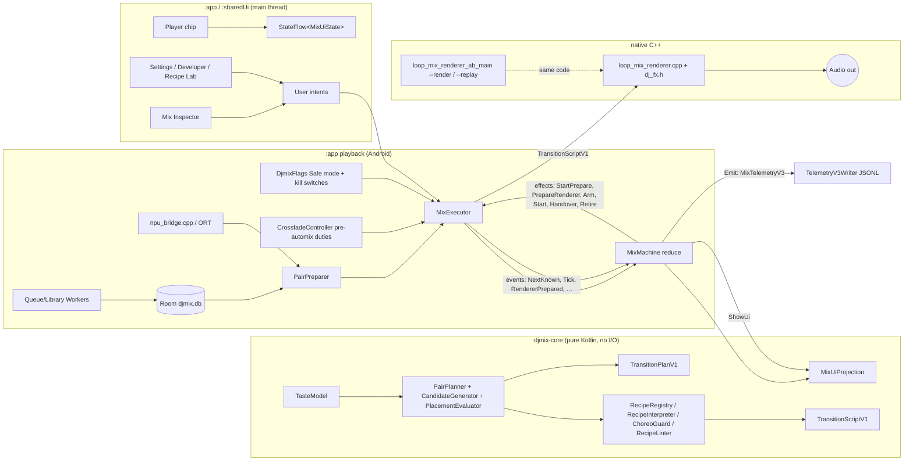

# AE3 Architecture

BitChord Automix Engine 3 (AE 3.0.0), release `1.10-djmix53` / versionCode 95.
This document is the B12 architecture reference: modules, data flow, thread model, dependency rules
(Part B1.1), the one architecture diagram, and the ADR index.

## Modules

| Module | Kind | Contents |
|---|---|---|
| `:djmix-core` | KMP `commonMain`, pure Kotlin, no Android, no I/O | `contracts/`, `machine/`, `planner/`, `recipes/`, `learning/`. Must compile and test on plain JVM in seconds. |
| `:shared` | KMP (upstream-owned except `playback/smart/**` paths listed in `tools/upstream-sync/fork-owned.txt`) | shared playback/domain code the fork keeps but does not own by default |
| `:sharedUi` | Compose Multiplatform UI | player, `MixViewPopup`, `PlayerControls`; automix UI strings in `sharedUi/src/commonMain/composeResources/values/mix_inspector.xml` (fork-owned) |
| `:app` | Android application | UI only for automix: player chip, Mix Inspector, Mix History, Settings, Developer settings; `app/build.gradle.kts` (+ fork-owned `app/djmix.gradle.kts`) |
| `npu-addon/v73` | standalone Gradle module (its own build, **not** in `settings.gradle.kts`) | code-less NPU add-on `com.music.bitchord.loopfix.npu.v73`; built by `.github/workflows/npu-addon.yml` |
| `native/` | C++ (host + Android) | `native/loopmix` (renderer, `dj_fx.h`), `native/analyzer` (+ `stretch`, `ffmpeg`, `onnxruntime`, `third_party`) |
| `app/src/main/cpp/jni/` | JNI | `loopmix_jni.cpp`, `analysis_jni.cpp`, `mel_jni.cpp`, `vocal_jni.cpp`, `stretch_jni.cpp`, `npu_bridge.cpp` |
| `tools/` | Python/shell, devbox | `mixq/`, `audition/`, `preps`-side `upstream-sync/`, `models/`, `npu/`, `train/`, `untangle/`, `audit-apk.sh`, `check_audiothread_alloc.py` |
| `backend/` | Go companion service (upstream) | not automix; excluded from the dependency rules below |

Key classes inside `:djmix-core`
(`djmix-core/src/commonMain/kotlin/com/music/bitchord/djmix/core/`):

- `contracts/` — `TrackAnalysisV3`, `TransitionPlanV1`, `TransitionScriptV1`, `RecipeV2`,
  `MixTelemetryV3`, `MixUiState`, `MixOutcome`, `EngineVersion.kt` (`ENGINE_VERSION = "3.0.0"`).
- `machine/` — `MixMachine` (pure reducer), `MixContract` (11 states, 20 events, effects), `MixMachineConfig`,
  `MixUiProjection`.
- `planner/` — `PairPlanner`, `CandidateGenerator`, `PlacementEvaluator`, `CamelotKey`, `BuiltInRecipeCatalog`, `PlannerInput`.
- `recipes/` — `RecipeRegistry`, `RecipeInterpreter`, `ChoreoGuard`, `RecipeLinter`, `BundledRecipesJson`.
- `learning/` — `TasteModel` (bounded per-recipe weights, ±0.30).

Android-side (`app/src/main/java/com/music/bitchord/playback/djmix/`):
`MixExecutor` (drives players + renderer from `MixMachine`), `PairPreparer` (runs planner jobs),
`store/` (`DjmixDatabase`, `DjmixAnalysisStore`, `TrackAnalysisV3Mapper` — Room `djmix.db`),
`npu/` (`ModelRegistry`, `InferenceBackend` with `CpuOrtBackend` + `QnnAddonBackend`, `OrchardNpuBridge`, `NpuSelfTestRunner`),
`diagnostics/` (`DiagnosticsBundler`, `TelemetryV3Writer`, `DjmixFlags`),
`work/` (`QueueAnalysisWorker`, `LibraryAnalysisWorker`), `StraightMixGeometry.kt`.
`CrossfadeController.kt` keeps pre-automix player management; every automix decision routes through `MixExecutor`.

## Dependency rules (Part B1.1)

1. `:djmix-core` depends on nothing (no Android, no I/O, no ORT). Nothing in it imports anything more
   volatile than itself; no cycles.
2. `:app` reads automix **state** (`StateFlow<MixUiState>`) and sends **intents**. It never touches the
   planner or renderer internals.
3. Only the Android playback layer talks to ExoPlayer/Media3 sinks and the native renderer.
4. `djmix-core` contracts are versioned (`schema` fields); consumers must tolerate adding fields but not
   removing/renaming them within one minor engine version.

## Data flow

Analysis → store → prepare → plan → script → render → observe:

1. `QueueAnalysisWorker` / `LibraryAnalysisWorker` (WorkManager) analyse upcoming tracks
   (`HEAD_TAIL` first, then `FULL`) into `TrackAnalysisV3` rows in Room (`djmix.db`:
   `track_analysis`, `stem_index`, `transition_history`, `preference`).
2. `PairPreparer` runs `PairPlanner` on `djmix-core` candidate generators (loop / bridge / straight
   geometry from `CandidateGenerator`), scores them with `PlacementEvaluator` (placement rules, hard
   rejects, taste weights from `TasteModel`), then **freezes** one `TransitionPlanV1`.
   Frozen plans are identified strictly by `(outTrackId, inTrackId, generation)`.
3. The interpreter (`RecipeInterpreter`) turns `RecipeV2` + pair context into a `TransitionScriptV1`;
   `ChoreoGuard` validates it; stems (`scnet_dyn_int8.onnx`) fill only the required decks/windows
   (`RecipeRequirementsV2.requiredStems`).
4. `MixExecutor` drives `MixMachine.reduce(state, event)` — a pure reducer on `djmix-core`. Effects
   (`Arm`, `Start`, `Handover`, `Retire`, …) are applied to the players + renderer; `ShowUi` publishes
   `MixUiState`; `Emit` appends `MixTelemetryV3` JSONL via `TelemetryV3Writer`.
5. The renderer (`native/loopmix/loop_mix_renderer.cpp` + `dj_fx.h`) plays the script. The same
   `TransitionScriptV1` renders bit-identically on the host CLI
   (`loop_mix_renderer_ab_main --render script.json --out out.wav`) when v2 setters are unused (ADR 0008).

## Thread model

Time-sensitive code is annotated (Part B13; enforced by `tools/check_audiothread_alloc.py` in CI):

| Annotation | Threads / executors | Allowed work |
|---|---|---|
| `@AudioThread` | the audio sink callback (renderer callback, surviving deck) | no decode, no inference, no allocation (`FloatArray(`, `ArrayList(`, `listOf(`, `Log.` are CI-flagged) |
| `@PrepThread` | prep executors: head/tail analysis, SCNet stems, region decode, `nativePrepare` of the renderer | everything expensive; runs ahead of the commit point |
| `@MainThread` | UI state collection, intents, WorkManager scheduling | state → UI projection only |

- The **audio thread does no work at transition time**: the renderer is prepared off-thread during READY
  (`RendererPrepared`), so arming only swaps a pointer.
- Preparation runs on the **prep thread**; the analysis model lock and the stem lock are separate.
  `PairPreparer` owns two dedicated daemon threads — **`djmix-prep`** (analysis → plan freeze →
  containment-aware decode → `nativePrepare`) and **`djmix-stems`** (a single-thread executor running
  SCNet stem separation) — so planning for a re-queue never queues behind a stem job.
- `djmix-prep` (analysis/stems/planning) and `djmix-stems` (per-deck SCNet separation) live inside
  `app/src/main/java/com/music/bitchord/playback/djmix/PairPreparer.kt`; WorkManager jobs
  (`work/QueueAnalysisWorker`, `work/LibraryAnalysisWorker`) feed the Room store the preparer reads.

## Diagram

## ADR index (`docs/adr/`)

| ADR | Title |
|---|---|
| 0001 | [One brain — PairPreparer decides, controller executes](adr/0001-one-brain-pair-preparer.md) |
| 0002 | [Prepared-only execution — countdown only when READY or ARMED](adr/0002-prepared-only-execution.md) |
| 0003 | [Orchard models and add-on — Nirovi + Syvenu](adr/0003-orchard-models-and-addon.md) |
| 0004 | [Version scheme — upstream base + djmix + engine](adr/0004-version-scheme.md) |
| 0005 | [MixMachine — transition state as a pure reducer](adr/0005-mixmachine-reducer.md) |
| 0006 | [Persistent analysis store — Room database](adr/0006-room-analysis-store.md) |
| 0007 | [Recipes as data — JSON v2 with interpreter and linter](adr/0007-recipes-as-data.md) |
| 0008 | [Deterministic floating-point flags for render bit-identity](adr/0008-deterministic-fp-bit-identity.md) |
| 0009 | [Ephemeral PhraseMaps / SongMaps fold into TrackAnalysis v3](adr/0009-in-memory-phrase-songmap-persistence.md) |
| 0010 | [Musicality first and brake rationing](adr/0010-musicality-first-and-brake-rationing.md) |

## What must keep working (survivors of the strangler migration, B1.2 item 5)

- the vc80 finite-loop and handover fixes; the vc81 ticker and lyric fixes;
- sticky user pause (`USER_REQUEST`) is never auto-resumed;
- the surviving session deck is never parked or reset while retiring the spare (`Running.survivingDeck` is
  pin `DeckTarget.IN` by a `require` in `MixContract.kt`);
- native probes stay bit-identical when v2 setters are unused;
- upstream 1.10 AutoMix visual state and artwork reveal;
- install with `adb install -r` only — never uninstall, never clear data (see [RELEASE.md](RELEASE.md)).
